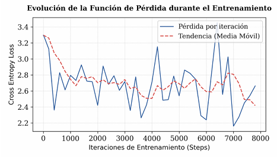
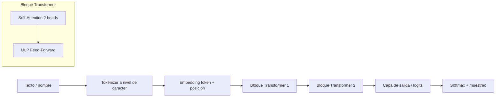
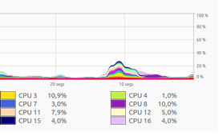

# 🔥 microGPT-Mojo

**Un modelo de lenguaje autorregresivo (estilo GPT) escrito desde cero en Mojo, sin PyTorch, sin TensorFlow, sin librerías externas.**

Basado en [microGPT](https://karpathy.github.io/) de Andrej Karpathy, llevado "al metal" con punteros, gestión manual de memoria y SIMD.

[📄 Leer el paper](docs/paper.pdf) · [💼 Post técnico](https://www.linkedin.com/feed/update/urn:li:ugcPost:7465521659249217536/) · [📝 Post del paper](https://www.linkedin.com/feed/update/urn:li:ugcPost:7465523750491443200/)

---

## ✨ ¿Qué es esto?

Proyecto final del **Curso de Especialización en IA y Big Data** del [Institut TIC de Barcelona](https://www.linkedin.com/school/iticbcn/).

El reto: implementar un GPT completo **sin ayuda de frameworks de alto nivel**, y hacerlo en **Mojo**, el lenguaje diseñado para maximizar el rendimiento en IA. Todo está hecho a mano:

- 🧮 **Forward** del Transformer (atención multi-head + MLP)
- 🔁 **Backpropagation** escrito desde cero, cálculo de gradientes incluido
- 🚀 **Optimizador Adam** implementado a mano
- ⚡ **Multiplicación de matrices con SIMD**, repartiendo el trabajo entre los cores de la CPU
- 🧠 **Punteros y gestión manual de memoria** para controlar el hardware

El modelo aprende a **generar nombres** a partir de un dataset de ~32.000 nombres, igual que el microGPT original.

---

## 🏗️ Arquitectura

| Hiperparámetro | Valor |
|---|---|
| Dimensión del embedding | **32** |
| Capas Transformer | **2** |
| Cabezas de atención | **2** |
| Dimensión oculta del MLP | **32** |
| Tamaño del vocabulario | **27** (26 letras + token BOS) |
| Documentos de entrenamiento | **32.033** nombres |
| Optimizador | Adam (implementado a mano) |

---

## 📊 Resultados

### Aprendizaje

La pérdida parte de ≈ **3.2957**, que coincide con `ln(27)`: el modelo empieza adivinando al azar entre los 27 tokens. A medida que entrena, baja hasta ≈ **2.2** y los nombres generados se vuelven cada vez más reales.

| Step | Loss | Nombre generado |
|---:|---:|---|
| 0 | 3.2957 | `zacarias` |
| 1000 | 2.7953 | `ikshan` |
| 3000 | 2.7171 | `kendall` |
| 5000 | 2.5397 | `bonita` |
| 6000 | 2.2389 | `khameron` |
| 7000 | 2.1603 | `adalia` |
| 7200 | 2.2749 | `aylie` |

> 📈 Gráfica de la curva de aprendizaje y comparativa completa en el [paper](docs/paper.pdf).

<!-- Cuando tengas la gráfica exportada del paper, descomenta:

-->

### Rendimiento y uso de CPU

La versión `mojoSIMD.mojo` reparte el cálculo entre varios cores. Aquí se ve el pico de uso repartido por los núcleos durante la ejecución:

### Comparativa de tiempos
 
Se compararon dos versiones de Mojo: la inicial con **listas de floats** y la optimizada con **punteros + SIMD** (`mojoSIMD.mojo`), ejecutadas con 3 semillas distintas para asegurar que el resultado no fuera casualidad.
 
| Semilla | Listas de floats | Punteros + SIMD | Mejora |
|---|---:|---:|---:|
| 42 | 5.76 s | 3.79 s | **34.2 %** más rápido (1.52×) |
| 190 | ~3.8 s | ~2.2 s | **~42 %** más rápido (~1.7×) |
| 15 | ~3.8 s | ~2.2 s | **~42 %** más rápido (~1.7×) |
| **Media** | | | **38.61 %** menos tiempo (≈1.6×) |
 
> Los valores de las semillas 190 y 15 están leídos de la gráfica del paper (la versión base ronda los 3.8 s y la SIMD los 2.2 s).
 
**¿Por qué es más rápido?** En la versión inicial, el procesador satura hilos sueltos (p. ej. CPU 12 llega al 22.8 % mientras el resto queda en mínimos). Con SIMD, el bucle de multiplicación de matrices se vectoriza y la carga se reparte de forma equilibrada entre los núcleos (~10 % en CPU 3, 8 y 11 a la vez).

## 🧠 Decisiones técnicas

- **Sin frameworks:** todo el autograd/backward está escrito a mano para entender y controlar cada operación.
- **SIMD:** la multiplicación de matrices, el cuello de botella del Transformer, se vectoriza.
- **Paralelismo:** cada core del procesador trabaja en su porción del cálculo.
- **Memoria manual:** punteros en lugar de estructuras de alto nivel para evitar overhead.

El razonamiento detrás de cada decisión y su impacto medido está detallado en el **[paper](docs/paper.pdf)**.

---

## 📄 Paper

📥 **[Descargar el documento técnico (PDF)](docs/paper.pdf)**

Incluye las decisiones de diseño, gráficas de aprendizaje y la mejora en tiempo de ejecución.

---

## 🙏 Agradecimientos

- **[Andrej Karpathy](https://karpathy.ai/)** por microGPT, la base e inspiración.
- **[Oriol Jaumà Lara](https://www.linkedin.com/in/oriol-jauma/)**, profesor que me guió durante todo el curso.
- **[Modular](https://www.modular.com/mojo)** por Mojo 🔥.